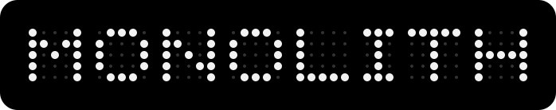
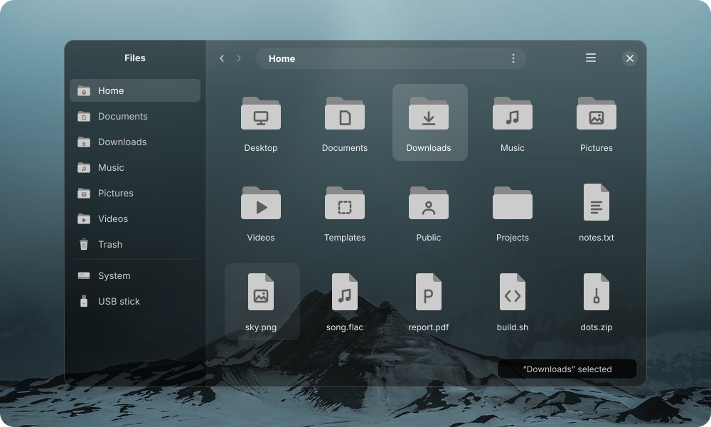
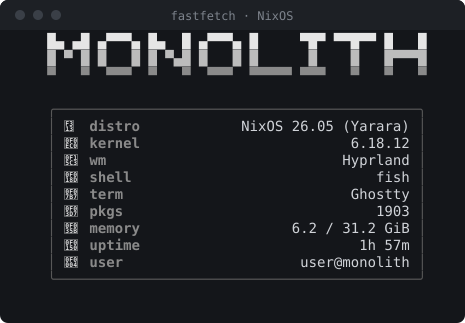
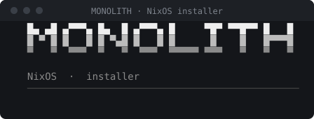
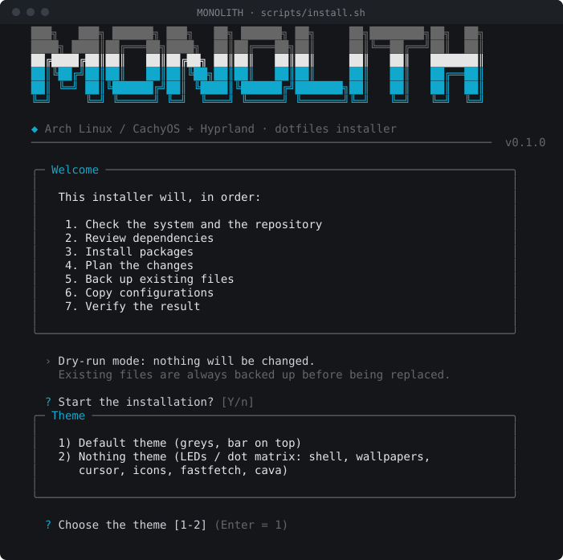
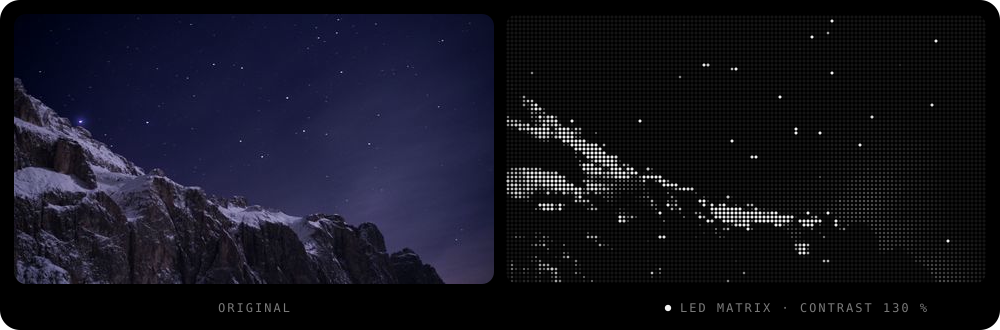
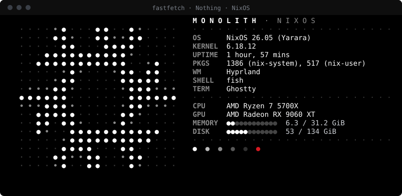
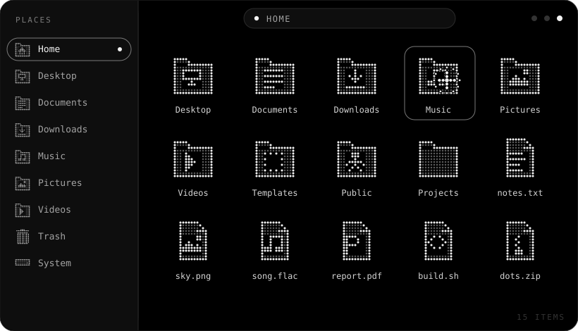
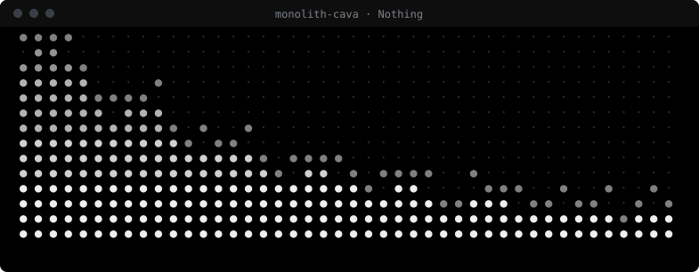
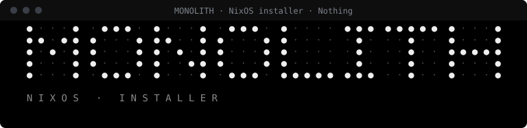

<p align="center">
  
</p>

<p align="center">
  <em>A monochrome Hyprland desktop: compositor, shell, terminal and tools in one repository.</em>
</p>

<p align="center">
  
  
  
  
  
</p>

<p align="center">
  <a href="README.pt-br.md">Português (Brasil)</a> &nbsp;·&nbsp; <strong>English</strong>
</p>

## Install

**Arch Linux / CachyOS**

```bash
git clone https://github.com/jhonatanoliveira2/monolith-dotfiles.git
cd monolith-dotfiles && ./scripts/install.sh
```

Your files are backed up first; `./scripts/restore.sh` undoes it. [Installation guide](docs/installation.md)

**NixOS**, from the installer ISO:

```bash
sudo nix --extra-experimental-features "nix-command flakes" run github:jhonatanoliveira2/monolith-dotfiles#install
```

[NixOS guide](docs/nixos.md)

Both installers ask for the theme: **default** or **Nothing** (LEDs and dot matrix). Installed from an old branch?
[Updating from an old branch](docs/migrating.md).

## Preview

### Default theme

<table>
  <tr>
    <td colspan="2"></td>
  </tr>
  <tr>
    <td width="50%"></td>
    <td width="50%"></td>
  </tr>
  <tr>
    <td colspan="2"></td>
  </tr>
</table>

### Nothing theme (optional)

LEDs and dot matrix, off unless you pick it in the installer or turn it on later
([Nothing theme](docs/nothing-theme.md)).

<details>
<summary>Show the Nothing theme previews</summary>
<br>

<table>
  <tr>
    <td colspan="2"></td>
  </tr>
  <tr>
    <td colspan="2"></td>
  </tr>
  <tr>
    <td colspan="2"></td>
  </tr>
  <tr>
    <td width="50%"></td>
    <td width="50%"></td>
  </tr>
</table>

</details>

## Docs

[Installation](docs/installation.md) · [NixOS](docs/nixos.md) · [Nothing theme](docs/nothing-theme.md) ·
[Keybinds](docs/keybinds.md) · [Configuration](docs/config.md) · [Dependencies](docs/dependencies.md) ·
[Troubleshooting](docs/troubleshooting.md) · [Updating from an old branch](docs/migrating.md) ·
[Contributing](CONTRIBUTING.en.md)

<p align="center">
  <sub><a href="LICENSE">MIT</a> · <a href="THIRD-PARTY-CREDITS.md">third-party credits</a> · the Nothing theme is not affiliated with Nothing Technology Limited</sub>
</p>
