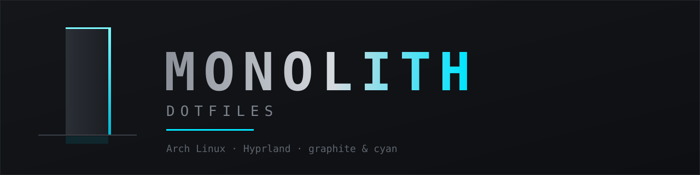
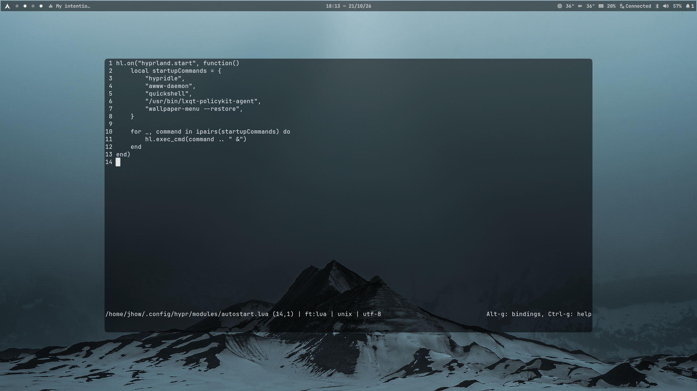
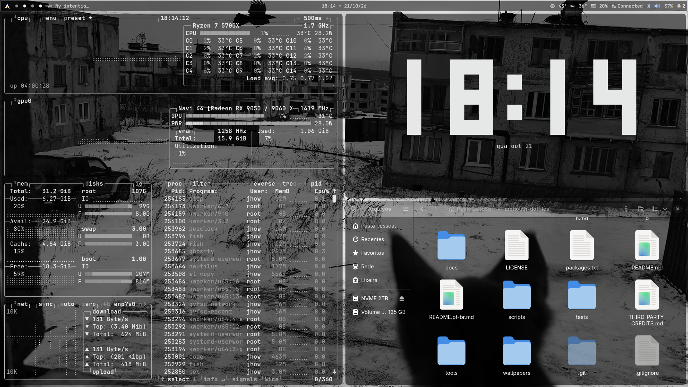
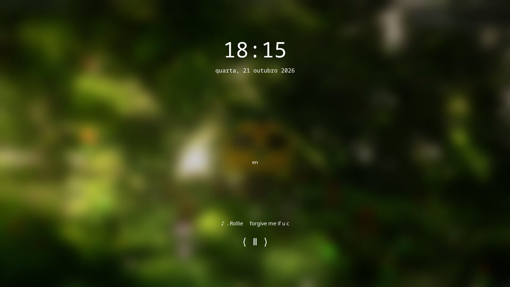
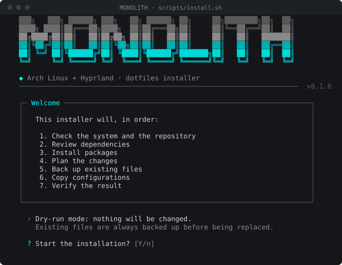
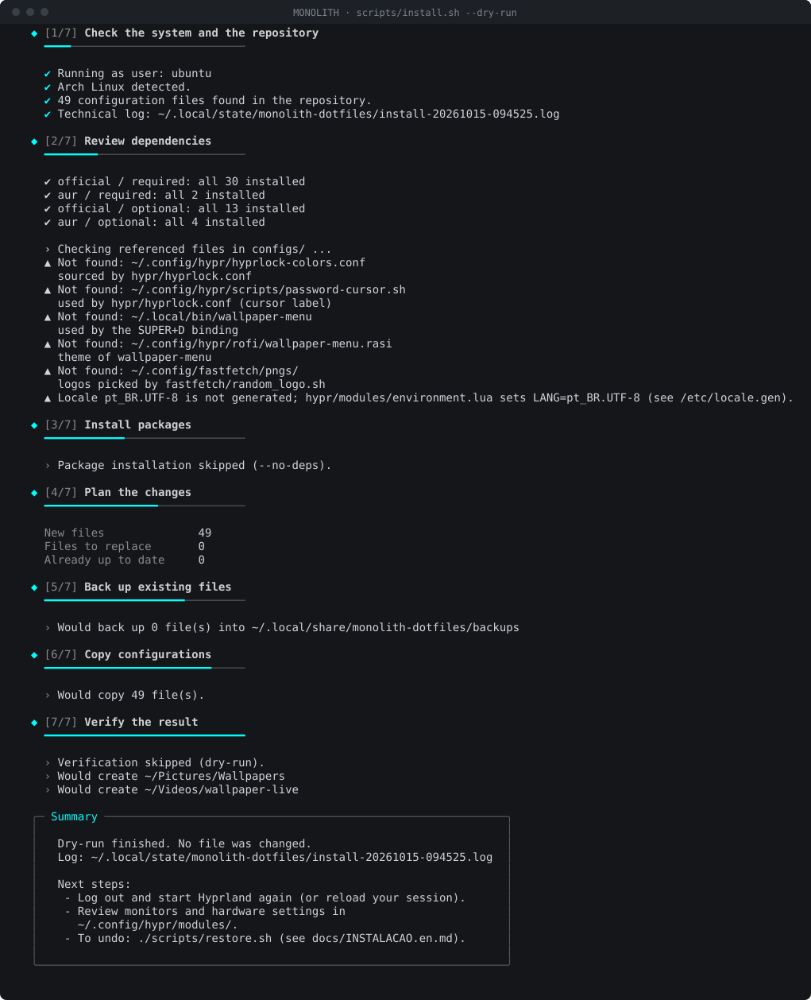

<p align="center">
  
</p>

<p align="center">
  <strong>Português (Brasil)</strong> · <a href="README.md">English</a>
</p>

<p align="center">
  
  
  
  
</p>

<h1 align="center">MONOLITH Dotfiles</h1>

## Previa 

[Video YouTube](https://youtu.be/W_SYo-i9fXk)


## Captura de tela 

<p align="center">
  
  
  
</p>

<p align="center">
  Um desktop integrado para Arch Linux com Hyprland, Quickshell e um instalador reversível.
</p>

<p align="center">
  <a href="#capturas-de-tela">Conheça o desktop</a> ·
  <a href="#início-rápido">Instale</a> ·
  <a href="#documentação">Leia os guias</a>
</p>

## Visão geral

O MONOLITH reúne compositor, shell gráfico, terminal, ambiente de shell, lançadores e configurações visuais em um só repositório. O instalador verifica dependências, cria cópias de segurança antes de substituir arquivos e pode reverter uma cópia interrompida. Algumas opções dependem do hardware; revise-as antes de aplicar as configurações em outra máquina.

| Camada do desktop | O que está incluído |
|---|---|
| Gerenciador de janelas | Hyprland, configurado em Lua e dividido em módulos |
| Shell gráfico | Barra, menus, notificações e controles do Quickshell |
| Terminal e shell | Ghostty, Fish, Starship e Atuin |
| Lançadores e arquivos | Rofi, Nautilus e seletor de wallpapers |
| Ferramentas pessoais | Configurações para Neovim, Micro e btop |
| Aparência | Ajustes GTK, paletas derivadas de wallpapers e shaders de cursor |

## O que diferencia o MONOLITH

- **Mudanças mais seguras:** arquivos existentes são copiados antes da substituição; cópias interrompidas são revertidas.
- **Execuções repetíveis:** arquivos idênticos são ignorados e arquivos pessoais ausentes do repositório são preservados.
- **Instalação transparente:** a verificação separa pacotes obrigatórios e opcionais e aponta arquivos referenciados que estão faltando.
- **Recuperação prática:** liste snapshots, restaure o mais recente ou escolha um backup específico.
- **Sem alterações silenciosas no sistema:** o instalador não troca o shell de login, não habilita serviços nem edita `/etc`.

> [!WARNING]
> Confira as opções específicas de monitor, entrada e idioma em [`docs/configuracao.md`](docs/configuracao.md) antes de instalar. Comece com uma simulação e mantenha os comandos de restauração à mão.

## Início rápido

**Requisitos:** Arch Linux, Bash 4.4+, Git e uma conta de usuário comum. A configuração Lua incluída requer Hyprland 0.55 ou superior. Um auxiliar do AUR (`paru` ou `yay`) só é necessário se você quiser que o instalador compile pacotes do AUR automaticamente.

```bash
git clone https://github.com/jhonatanoliveira2/monolith-dotfiles.git
cd monolith-dotfiles
./scripts/install.sh
```

O instalador copia as configurações que já estão em `configs/` para sua pasta pessoal. Também instala pacotes, a menos que você use `--no-deps`, e coloca os wallpapers incluídos em `~/Pictures/Wallpapers` e `~/Videos/wallpaper-live`.

<details>
  <summary><strong>Backup e recuperação</strong></summary>

  ```bash
  ./scripts/backup.sh --list
  ./scripts/restore.sh
  ./scripts/restore.sh --dry-run
  ```

  Os backups ficam em `~/.local/share/monolith-dotfiles/backups/`. Consulte o [guia de instalação](docs/Instalacao.md#backup-e-recuperação) para restaurar um snapshot específico ou recuperar arquivos manualmente.
</details>

## Prévia do instalador

<p align="center">
  
</p>

<details>
  <summary>Ver outra tela do instalador</summary>
  <p align="center"></p>
</details>

## Documentação

| Guia | English | Português (Brasil) |
|---|---|---|
| Instalação e recuperação | [Installation](docs/Installation.md) | [Instalação](docs/Instalacao.md) |
| Configuração e notas de hardware | [Configuration](docs/config.md) | [Configuração](docs/configuracao.md) |
| Justificativas dos pacotes | [Dependencies](docs/dependencies.md) | [Dependências](docs/Dependencias.md) |
| Problemas comuns | [Troubleshooting](docs/Troubleshooting.md) | [Solução de problemas](docs/Problemas-conhecidos.md) |
| Contribuição | [Contributing](CONTRIBUTING.en.md) | [Contribuindo](CONTRIBUTING.md) |

## Estrutura do repositório

```text
configs/                 Configurações de desktop instaladas na pasta pessoal
scripts/                 Instalador, backup, restauração, verificações e importação
docs/                    Guias em inglês e português do Brasil
assets/                  Identidade visual, prévias e espaços de screenshots
wallpapers/              Wallpapers estáticos e animados incluídos
tests/                   Testes do instalador e da documentação
tools/                   Utilitário para renderizar prévias do terminal
packages.txt             Relação de pacotes oficiais, opcionais e AUR
LICENSE                  MIT
```

O instalador e os arquivos de configuração são fornecidos como estão. Leia os [créditos e avisos de licença](THIRD-PARTY-CREDITS.md) antes de redistribuir componentes incluídos.
