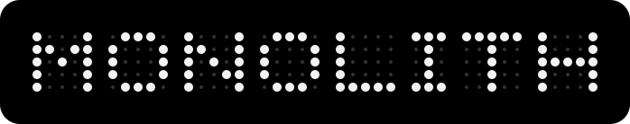
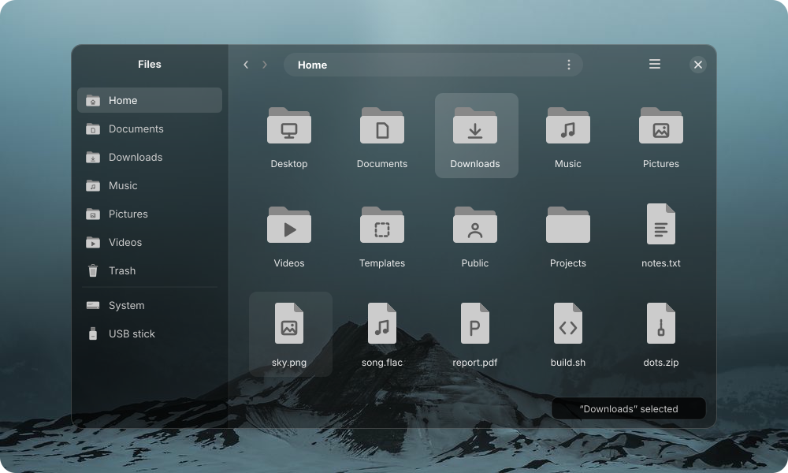
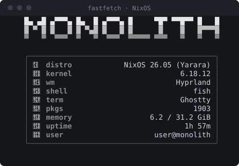
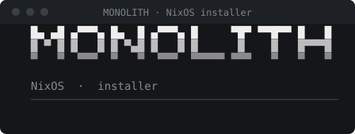
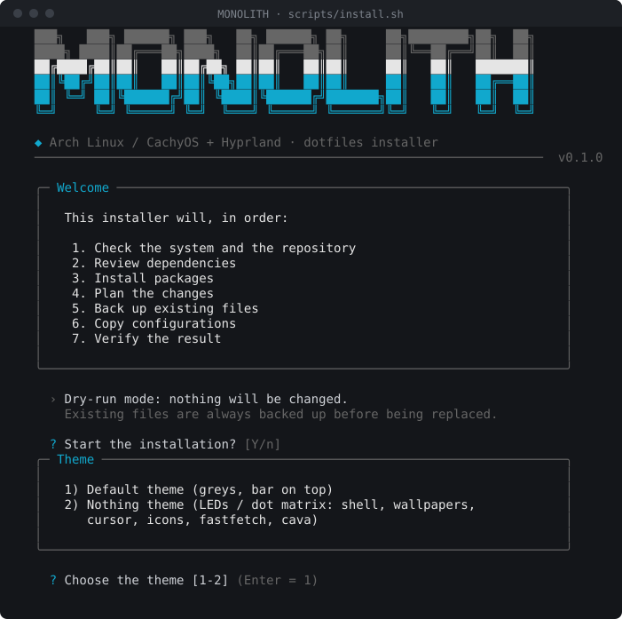
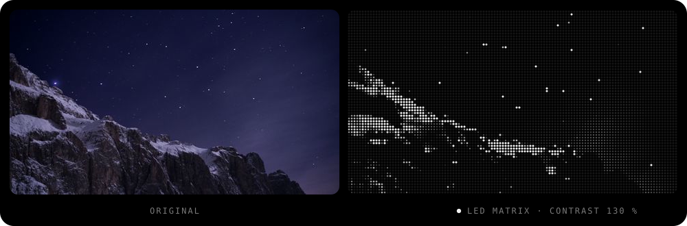
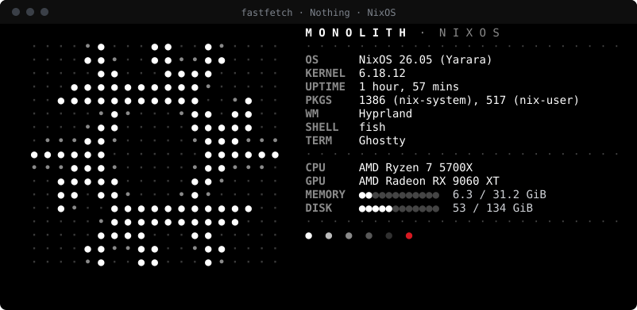
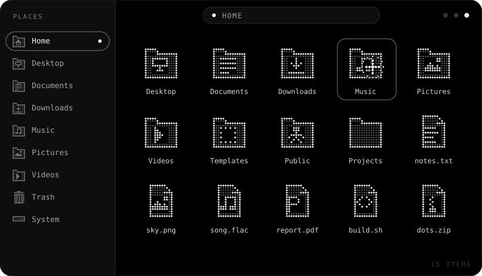
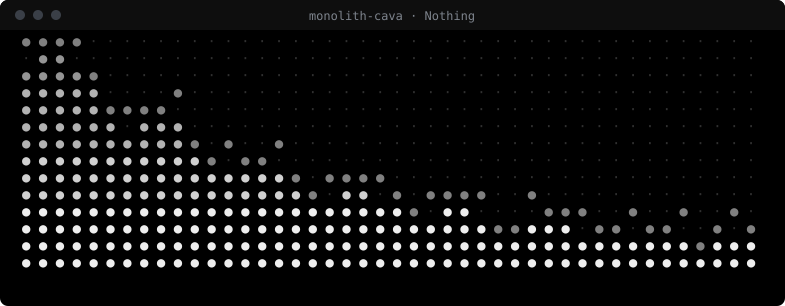
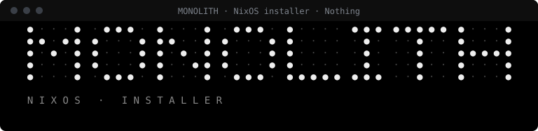

<p align="center">
  
</p>

<p align="center">
  <em>Um desktop Hyprland monocromático: compositor, shell, terminal e ferramentas em um só repositório.</em>
</p>

<p align="center">
  
  
  
  
  
</p>

<p align="center">
  <strong>Português (Brasil)</strong> &nbsp;·&nbsp; <a href="README.md">English</a>
</p>

## Instalação

**Arch Linux / CachyOS**

```bash
git clone https://github.com/jhonatanoliveira2/monolith-dotfiles.git
cd monolith-dotfiles && ./scripts/install.sh
```

Seus arquivos passam por backup antes; `./scripts/restore.sh` desfaz. [Guia de instalação](docs/instalacao.md)

**NixOS**, pela ISO de instalação:

```bash
sudo nix --extra-experimental-features "nix-command flakes" run github:jhonatanoliveira2/monolith-dotfiles#install
```

[Guia do NixOS](docs/nixos.pt-br.md)

Os dois instaladores perguntam o tema: **padrão** ou **Nothing** (LEDs e matriz de pontos). Instalou a partir de uma
branch antiga? [Atualizar a partir de uma branch antiga](docs/migracao.md).

## Prévia

### Tema padrão

<table>
  <tr>
    <td colspan="2"></td>
  </tr>
  <tr>
    <td width="50%"></td>
    <td width="50%"></td>
  </tr>
  <tr>
    <td colspan="2"></td>
  </tr>
</table>

### Tema Nothing (opcional)

LEDs e matriz de pontos, desligado a menos que você o escolha no instalador ou o ligue depois
([Tema Nothing](docs/nothing-theme.pt-br.md)).

<details>
<summary>Mostrar as prévias do tema Nothing</summary>
<br>

<table>
  <tr>
    <td colspan="2"></td>
  </tr>
  <tr>
    <td colspan="2"></td>
  </tr>
  <tr>
    <td colspan="2"></td>
  </tr>
  <tr>
    <td width="50%"></td>
    <td width="50%"></td>
  </tr>
</table>

</details>

## Documentação

[Instalação](docs/instalacao.md) · [NixOS](docs/nixos.pt-br.md) · [Tema Nothing](docs/nothing-theme.pt-br.md) ·
[Atalhos](docs/atalhos.md) · [Configuração](docs/configuracao.md) · [Dependências](docs/dependencias.md) ·
[Problemas conhecidos](docs/problemas-conhecidos.md) · [Atualizar a partir de uma branch antiga](docs/migracao.md) ·
[Contribuindo](CONTRIBUTING.md)

<p align="center">
  <sub><a href="LICENSE">MIT</a> · <a href="THIRD-PARTY-CREDITS.md">créditos de terceiros</a> · o tema Nothing não tem vínculo com a Nothing Technology Limited</sub>
</p>
